  

  
  
  

### 👋 About me

I'm an AI engineer with 7+ years of Python. I lead an AI team at **Live Chat Global**, where we build a multi-tenant customer support platform that answers across chat, email and other channels with Claude, OpenAI and Pinecone. Before moving into AI I spent years building backend systems in FastAPI and Django, and I still write most of the hard code myself. I've worked with clients in the US, Canada and the EU.

### 🧠 What I work on

- **AI Autopilot** across 4 support channels, grounded in 11 knowledge-base integrations (Python 3.12, FastAPI, the Claude and OpenAI APIs, Pinecone)
- **Multi-model consensus answering**: Claude and OpenAI responses are cross-checked before delivery to reduce hallucinations, built without LangChain or LlamaIndex
- **Multi-tenant RAG** with Pinecone namespaces, org-scoped retrieval and JWT auth for strict tenant isolation
- **A resilient LLM service layer** with provider failover, response validation and token optimization, so cost per conversation stays predictable
- **Computer-vision damage inspection**: a YOLO detection microservice on FastAPI and a three-phase training pipeline, with GPT-4o and Pinecone RAG turning detected damage into itemized repair estimates

### 🚀 Featured projects

<table>
<tr>
<td width="50%" valign="top">

**[llmgater](https://github.com/lzradeel/llmgater)**: an async Python LLM gateway in front of OpenAI, Anthropic and any OpenAI-compatible server.

- Provider failover with jittered backoff, `Retry-After` support and per-attempt or per-chunk deadlines
- A similarity cache scoped per account and conversation, plus per-account token quotas
- PII redaction, prompt-injection blocking and Pydantic-validated outputs with automatic repair
- 2 runtime dependencies, 161 offline tests, `mypy --strict`, CI on Python 3.11 to 3.14

</td>
<td width="50%" valign="top">

**[answerpg](https://github.com/lzradeel/answerpg)**: a RAG service that answers questions over your docs with citations, from a single PostgreSQL + pgvector database.

- Hybrid search: BM25 in SQL and pgvector HNSW, fused by reciprocal rank
- Cross-encoder reranking and `[n]` citations, with extractive or Anthropic-written answers
- A CI quality gate on 40 questions and 5 metrics: recall@5 **0.963**, MRR **0.872**
- A FastAPI service that logs timings, tokens and cost per request in Postgres, with a Docker demo

</td>
</tr>
</table>

### 🛠️ Tech stack

**AI and LLMs**

       

**Backend and APIs**

   

**Data, cloud and testing**

### 📫 Get in touch

The best way to reach me is [lzradeel@gmail.com](mailto:lzradeel@gmail.com). I'm always happy to talk about LLM systems, RAG and Python backends.
